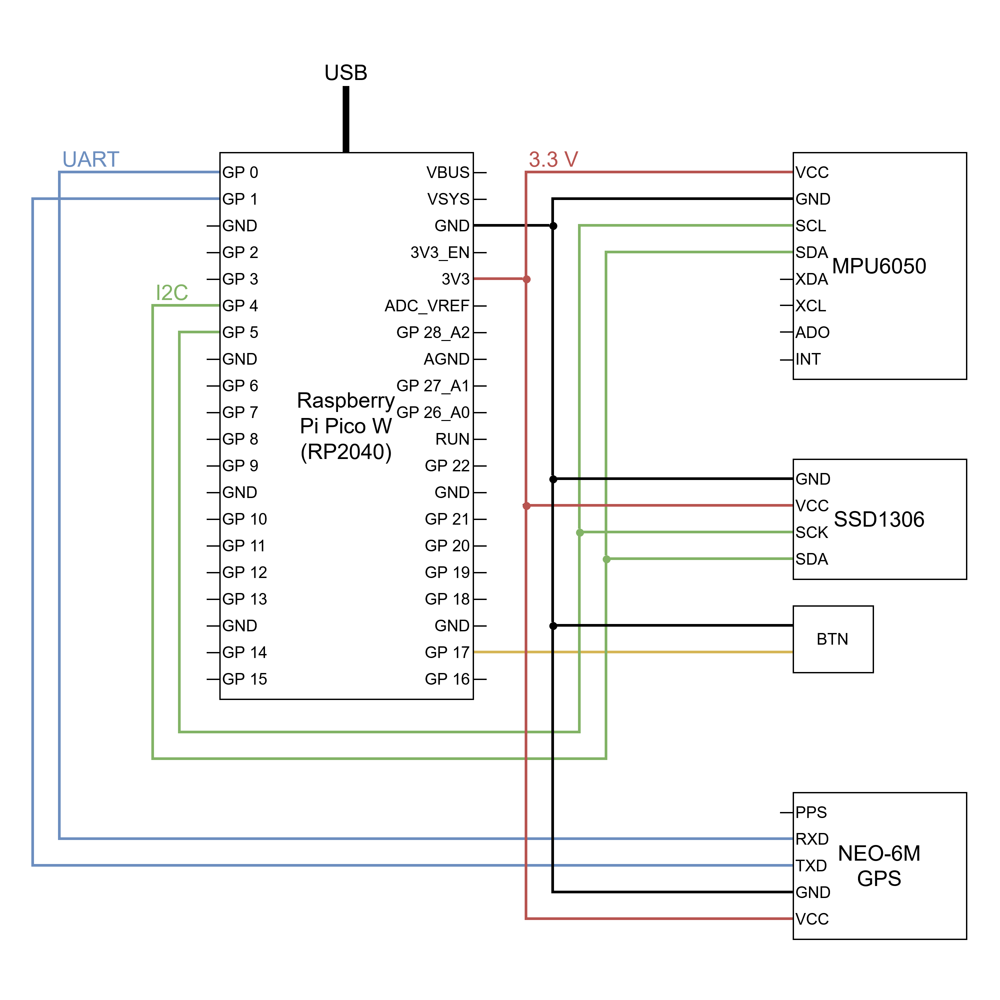

# GPS and IMU Sensor Unit

### Device funcionality

Every second, MCU reads sensor raw data and computes exact location, acceleration/speed, direction of the movement. Results will be shown on the OLED display clearly. We also may add a small arrow showing a direction of the movement or a GPS and WiFi sign for indicating network stability - all of this is optional and doesn't need to be included in the code.

###  Program Functionality and Timing

The main application integrates the GPS NEO-6M,
MPU-6050 and SSD1306 OLED display using MicroPython
on the Raspberry Pi Pico W.

The program uses a non-blocking main loop with
periodically scheduled operations based on
  `time.ticks_ms()`.

###  Task Scheduling

| Task | Interval | Description |
|------|----------|-------------|
| GPS data reception | Every loop (~10 ms minimum) | Reads available NMEA data through UART0 and checks GPS fix validity. |
| IMU measurement | 100 ms (10 Hz) | Reads acceleration and angular velocity from MPU-6050 via I2C0. |
| OLED update | 500 ms (2 Hz) | Displays current GPS or IMU measurements. |
| Display page switching | 5000 ms (5 s) | Automatically switches between GPS and IMU screens. |
| Serial terminal output | 1000 ms (1 Hz) | Prints GPS and IMU measurements for debugging. |
| GPS fix timeout | 3000 ms (3 s) | Invalidates GPS measurements if no recent valid fix is received. |
| Gyroscope calibration | Once at startup (~2 s) | Calculates gyroscope offsets while the sensor remains stationary. |
| Main loop delay | 10 ms | Reduces unnecessary CPU usage. |

### Member roles

- Tadeas Klimt -  oled.py -> grafical user interface + main.py responsibility, overall repository 
- Josef Cvejn  -  gyros.py -> gyroscope calibration & library + repository (components and links)
- Pavel Curda  -  gps.py -> gps module parsing, calibration & library + main device schematic

###  Timing and Concurrency

The program uses a cooperative scheduling approach
without threads or asynchronous tasks.

The main loop checks elapsed time using
  `time.ticks_ms()` and `time.ticks_diff()`.

This allows GPS reception, IMU measurements and
OLED updates to run at different intervals.

GPS data is processed continuously when available,
while IMU readings and display updates are performed
periodically.

The gyroscope calibration is performed once during
startup and temporarily blocks the main loop.

###  Error Handling

The program includes basic error handling:

-	Invalid GPS fixes are clearly indicated.
-	Outdated GPS coordinates are rejected.
-	I2C devices are checked during initialization.
-	Sensor communication errors are reported.
-	Unavailable IMU data is not displayed as a valid measurement.

**Note:** The listed intervals are software scheduling
targets. Actual timing may vary depending on UART data
processing, I2C communication and display updates.
________________________________________

## Hardware Components

This project uses a Raspberry Pi Pico W microcontroller to collect
GPS position data and measurements from an IMU sensor.
The measured values are displayed on an OLED screen.
### Bill of Materials (BOM)

| No. | Component | Model | Quantity | Purpose |
|-----|-----------|-------|----------|---------|
| 1 | Microcontroller | Raspberry Pi Pico W | 1 | Main control unit |
| 2 | GPS Module | u-blox NEO-6M | 1 | GPS position and speed |
| 3 | Gyroscope & Accelerometer | MPU-6050 (GY-521) | 1 | Angular velocity and acceleration |
| 4 | OLED Display | SSD1306 (I2C, 128x64) | 1 | Displaying measured data |
| 5 | Pressure Sensor (Optional) | BMP280 / BME280 | 1 | Atmospheric pressure measurement |
| 6 | Breadboard | 400/830 tie-points | 1 | Prototype assembly |
| 7 | Jumper Wires | Dupont | 1 set | Electrical connections |
| 8 | USB Cable | Micro-USB | 1 | Power supply and programming |
| 9 | Button | Unknown | 1 | Switching between screen modes |

________________________________________

## Communication Interfaces

| Component | Interface | Pico W Pins |
|-----------|-----------|-------------|
| GPS NEO-6M | UART0 | GP0 (TX), GP1 (RX) |
| IMU MPU-6050 | I2C0 | GP4 (SDA), GP5 (SCL) |
| OLED SSD1306 | I2C0 | GP4 (SDA), GP5 (SCL) |
The IMU sensor and OLED display share the same I2C bus.
________________________________________

## Pin Connections

### GPS NEO-6M

-	GPS TX -> Pico GP1 (UART0 RX)
-	GPS RX -> Pico GP0 (UART0 TX)
-	GPS VCC -> Compatible power supply
-	GPS GND -> Pico GND

## IMU MPU-6050

-	VCC -> Pico 3V3
-	GND -> Pico GND
-	SDA -> Pico GP4
-	SCL -> Pico GP5

## OLED SSD1306

-	VCC -> Pico 3V3
-	GND -> Pico GND
-	SDA -> Pico GP4
-	SCL -> Pico GP5
________________________________________

## Power Supply

-	Raspberry Pi Pico W: 5 V via USB
-	IMU MPU-6050: 3.3 V
-	OLED SSD1306: 3.3 V
-	GPS NEO-6M: According to module specifications
-	Common GND for all components
________________________________________

## Software

-	**Programming Language:** MicroPython
-	**Development Environment:** Thonny / Visual Studio Code
-	**Version Control:** Git / GitHub
________________________________________

## Project Functionality

1.	Receive GPS data via UART.
2.	Check GPS fix status.
3.	Read acceleration and angular velocity from IMU.
4.  Process sensor data using Raspberry Pi Pico W.
5.	Display GPS and IMU measurements on OLED.
6.	Indicate unavailable or invalid GPS data.
________________________________________

## Schematic

________________________________________

## Hardware Component Testing

###  1.  MPU - 6050 - Gyroscope and Accelerometer

The MPU-6050 was successfully tested using
Raspberry Pi Pico W and MicroPython.

Acceleration and angular velocity data were
successfully measured using I2C communication.

**Test Status:** Successful

-	[MPU-6050 Documentation](test%20codes/MPU6050.md)
-	[MPU-6050 test code](test%20codes/MPU6050.py)

________________________________________

###  2.  NEO - 6M Module

The NEO-6M GPS module will be connected to the
Raspberry Pi Pico W using the UART0 interface.

The module will be used to receive GPS coordinates,
speed and satellite fix status.

The test will verify UART communication, NMEA data
reception and GPS fix validity.

**Test Status:** Successful

-	[NEO-6M Documentation](test%20codes/NEO-6M.md)
-	[NEO-6M test code](test%20codes/NEO-6M.py)
________________________________________

###  3.  SSD1306 – OLED Display

The SSD1306 OLED display will be connected to the
Raspberry Pi Pico W using the I2C0 interface.

The display will be used to show GPS coordinates,
speed, Wifi connection, GPS fix status and IMU measurements.

The test will verify I2C communication, text
rendering and display updates using MicroPython.

**Test Status:** Successful

-	[OLED Documentation](test%20codes/oled.md)
-	[OLED test code](test%20codes/oled.py)

##  System Integration

###  Integration of GPS, IMU and OLED Display

During the third week, the individually tested hardware components are being integrated into a single system controlled by the Raspberry Pi Pico W.
The main application is developed in MicroPython and combines three hardware modules:

-	**MPU-6050:** Measures acceleration and angular velocity using I2C communication.
-	**NEO-6M GPS:** Provides GPS coordinates, speed and satellite fix status using UART communication.
-	**SSD1306 OLED:** Displays the processed GPS and IMU measurements using I2C communication.
________________________________________

###  Software Integration

Each component is implemented as a separate software module to simplify testing, maintenance and integration.
The main application is responsible for:

1.	Initializing all connected hardware modules.
2.	Reading GPS and IMU sensor data.
3.	Processing and validating the received measurements.
4.	Displaying selected information on the OLED screen.
5.	Handling unavailable GPS data and communication errors.

###  Main Application

The main program combines the individual modules into one application.

**Main Python Code:** [main.py](LINK_TO_MAIN_CODE)

